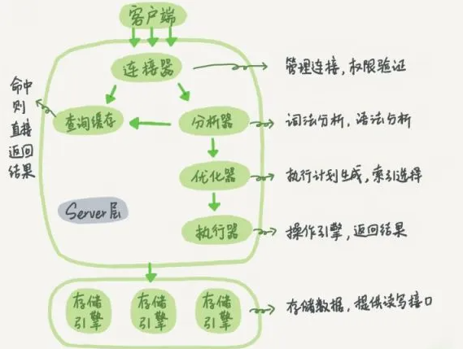
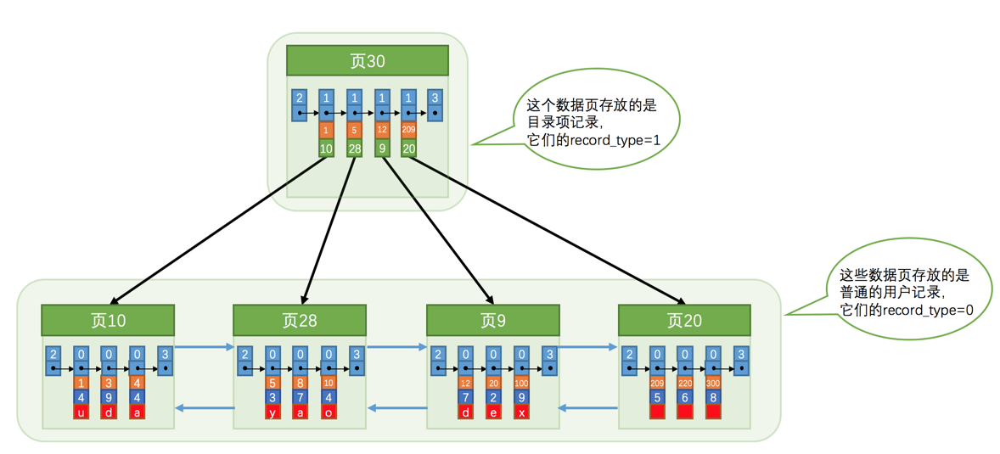
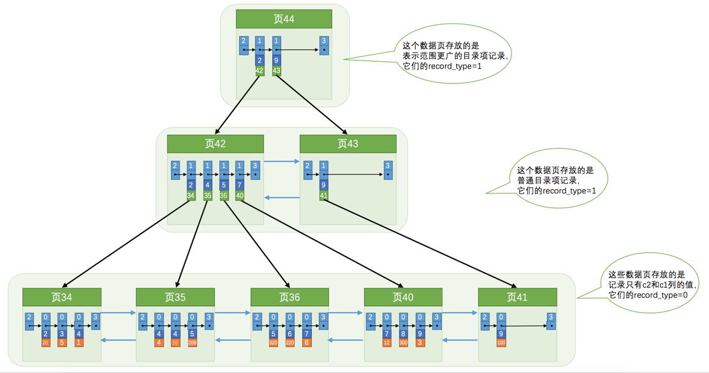
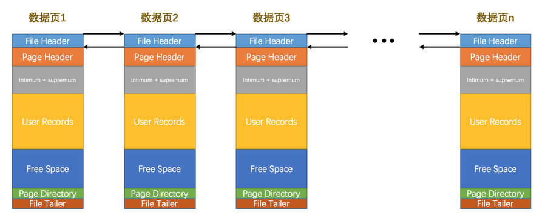
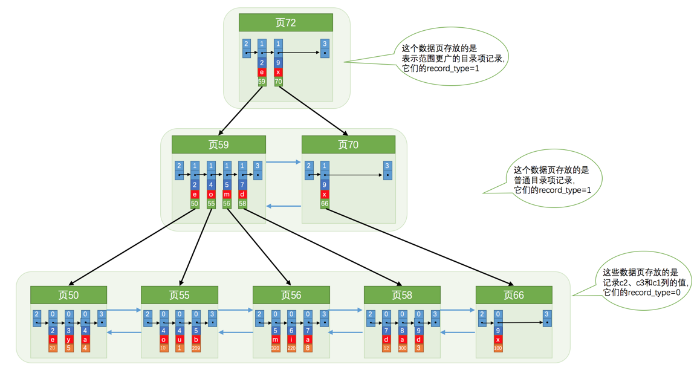

# MySQL 调优与 InnoDB 机制

MySQL 调优的目标是用可验证的证据减少不必要的 CPU、内存、磁盘 I/O、锁等待和网络传输。本文以 MySQL 8.4+ 和 InnoDB 为基线，保留页存储、行存储、页目录、B+Tree、事务和锁的示意内容，再补充执行计划与上线验证方法。

<!-- more -->

::: tip 阅读说明

文中的页大小、树高、行数和 I/O 次数是帮助理解的估算，不能直接当成任何实例的性能承诺。实际判断应结合表结构、数据分布、`EXPLAIN ANALYZE`、慢查询日志和锁等待信息。

MySQL 8.0 已移除 Query Cache。当前调优应关注 Buffer Pool、统计信息、执行计划、连接池、事务长度和实际 I/O。

页结构与 B+Tree 的部分示意图参考了 [mysql-learning-notes@1fcd2c9](https://github.com/Relph1119/mysql-learning-notes/tree/1fcd2c9/docs/mysql) 的第 5～7 章，并将图像复制到本文同目录的 `img/` 中。参考资料用于帮助理解内部结构；涉及版本差异的结论以 MySQL 8.4 文档和实际执行计划为准。

:::

## 1. 查询执行链路

### 1.1 从连接到结果

一条 SQL 通常经过以下阶段：

1. **连接与认证**：客户端连接服务器，连接器检查身份、权限和会话参数。
2. **解析与预处理**：解析 SQL 语法，确认表、列和别名，构造内部表示。
3. **优化**：根据统计信息、索引和成本模型选择访问路径、连接顺序、排序与聚合策略。
4. **执行**：执行器调用存储引擎读取或修改数据。InnoDB 会在需要时从 Buffer Pool 或磁盘读取数据页。
5. **返回结果**：服务器处理结果集并通过连接返回客户端。



### 1.2 存储引擎边界

| 引擎 | 主要特性 | 调优关注点 |
| --- | --- | --- |
| `InnoDB` | 聚簇索引、事务、MVCC、行级锁和崩溃恢复 | 索引设计、Buffer Pool、事务长度、锁等待和日志 I/O |
| `MyISAM` | 数据文件与索引文件分离，不提供 InnoDB 的事务能力 | 仅适合兼容旧系统的场景，新表通常不应选用 |

本文后续内容均以 InnoDB 为主。

## 2. InnoDB 存储结构

### 2.1 页存储机制

- **操作系统内存页**：常见为 4 KiB，但操作系统、文件系统和硬件可能不同。
- **InnoDB 页大小**：默认通常为 16 KiB，具体值可以查询：

```sql
SHOW VARIABLES LIKE 'innodb_page_size';
```

一个数据页可以包含页头、系统记录、用户记录、空闲空间、页目录和页尾等区域：


```text
File Header
Page Header
Infimum + Supremum Records
User Records
Free Space
Page Directory
File Trailer
```

页目录只负责在**一个数据页内部**帮助定位记录组，通常先用二分查找缩小范围，再在记录组内查找。它不是独立的 B+Tree；多个数据页之间的层级关系才组成索引 B+Tree。

### 2.2 InnoDB 行格式

| 行格式 | 特点 | 适用说明 |
| --- | --- | --- |
| `Compact` | 变长字段长度、`NULL` 标志、记录头和列数据的紧凑格式 | 兼容旧表；新表通常使用 `Dynamic` |
| `Redundant` | 更早的兼容格式 | 仅在维护旧表时遇到 |
| `Dynamic` | 大字段可以放在溢出页，行内保留必要指针 | MySQL 8.4 的常用默认选择 |
| `Compressed` | 在类似 `Dynamic` 的存储方式上增加页压缩 | 以 CPU 换取磁盘空间和 I/O，需实测 |

设置语法：

```sql
CREATE TABLE example (
  id BIGINT PRIMARY KEY
) ENGINE = InnoDB ROW_FORMAT = DYNAMIC;

ALTER TABLE example ROW_FORMAT = DYNAMIC;
```

### 2.3 行存储特性

- **行大小限制**：`65,535` 字节是 MySQL 行格式的逻辑上限，实际还受列类型、字符集、页大小以及 `TEXT`/`BLOB` 溢出存储影响。
- **隐藏列**：
  - `DB_ROW_ID`（6 字节）：没有主键且没有合适的非空唯一索引时生成。
  - `DB_TRX_ID`（7 字节）：记录最近修改它的事务 ID。
  - `DB_ROLL_PTR`（7 字节）：指向 Undo Log 中的旧版本。
- **行溢出处理**：大字段可能存储在其他页，聚簇记录中保留指向溢出数据的指针；具体布局取决于行格式和列大小。

## 3. 索引机制

### 3.1 B+Tree 索引结构

```text
根节点（非叶子节点）
        ↓
中间节点（非叶子节点，存储键值与指针）
        ↓
叶子节点（聚簇索引保存行；二级索引保存索引列与聚簇键）
```

**特点**：

- 非叶子节点主要存储键值和子页指针，负责导航。
- 叶子节点按键值有序连接，支持高效范围查询。
- 每个节点可以存储多个元素，相比二叉树通常具有更低的高度。

### 3.2 索引存储计算

- 假设主键为 `BIGINT`（8 字节），页指针占 6 字节。
- 忽略页头和其他开销时，单页可容纳的键值与指针组合约为 `16 KiB / (8 + 6) ≈ 1170`。
- 如果假设叶子页每页存放 16 行，两个导航层的数量级估算约为 `1170 × 1170 × 16` 行。

以上只是便于理解的估算。真实容量还受到页目录、记录头、变长列、主键宽度、填充率、页分裂和碎片影响，不能直接当成容量承诺，也不能由此推导固定的查询耗时。

### 3.3 索引使用原则

#### 辅助索引（二级索引）

- 除主键索引之外创建的普通索引都属于二级索引。
- 二级索引叶子页保存索引列和聚簇索引键；需要返回完整行时，会根据聚簇键回到聚簇索引查找，这个过程称为**回表**。
- 只需要索引列即可返回结果的查询可以使用覆盖索引，减少回表。





::: tip MySQL 8.4 语义

InnoDB 没有主键时，会选择第一个所有键列均为 `NOT NULL` 的唯一索引作为聚簇索引；如果仍没有合适索引，会生成隐藏的聚簇键。二级索引叶子节点包含聚簇索引键，因此主键过宽会放大每个二级索引的空间成本。

:::

#### 最左前缀原则

对于联合索引 `INDEX idx_bcd (b, c, d)`，优化器通常先利用最左列 `b` 定位，再根据 `c`、`d` 缩小范围：

```sql
-- 通常可以使用 b、c、d
SELECT * FROM t1 WHERE b = 1 AND c = 1 AND d = 1;

-- 通常可以使用 b、c
SELECT * FROM t1 WHERE b = 1 AND c = 1;

-- 通常只能把 b 用作范围条件；c、d 是否继续用于索引要看执行计划
SELECT * FROM t1 WHERE b > 1 AND c = 1;

-- 缺少 b，通常无法按普通最左前缀定位
SELECT * FROM t1 WHERE c = 1 AND d = 1;

-- 前导通配符通常无法使用普通 B+Tree 的有序定位
SELECT * FROM t1 WHERE b LIKE '%101%';
```

“最左前缀”描述的是常规索引定位规则，不应被理解成绝对的“命中/不命中”二分法。MySQL 版本、索引统计信息、索引跳跃扫描、回表成本和结果集大小都可能改变最终计划，必须使用 `EXPLAIN` 验证。

#### 索引优化技巧

- 后缀匹配 `LIKE '%com'` 通常不能使用普通 B+Tree。稳定的后缀查询可以维护反转列，再把查询改写为前缀匹配；是否值得这样做要根据写入成本和查询频率评估。
- `NULL` 可以参与索引排序和查找，不要简单地把它判断为“不会命中索引”。
- 非唯一二级索引的索引键相同时，InnoDB 会把聚簇索引键作为隐藏的比较部分，以区分记录。
- 等值条件通常放在联合索引的范围条件之前；索引列顺序仍需结合真实查询和数据分布设计。

### 3.4 页目录与目录页

#### 页目录（Page Directory）

页目录位于每个数据页内部，用槽位记录若干记录组的位置，帮助在页内进行二分查找。下面的示意图表示页内记录与槽位的关系：

```text
              页号 100                       页号 200
            1 ->  1111a                   5 -> 5555e
                  2222b       ->               6666f
            3 ->  3333c...                7 -> 7777g ...
```

#### 目录页（B+Tree 非叶子页）

目录页是索引树中的非叶子页，用键值和页指针导航到其他数据页。它与数据页内部的 Page Directory 不是同一个概念：

```text
                    1                          5            ← 分隔键
                   100                        200            ← 页指针
                    │                          │
                 页号 100                   页号 200          ← 指向数据页
```

- **key**：用于表示子页范围的分隔键，通常与索引键的有序排列相关。
- **value**：指向对应子页的页号或页地址。

因此，索引树由根页、目录页和叶子页共同组成；一个节点可以存放多个元素，叶子页再按键值连接以支持范围扫描。

```text
                                 0003 0005
             │                       │                         │
           0002                    0004                      0005
        │         │           │            │              │            │
    0001   →    0002   →    0003    →    0004   →    0005   →    0006  0007
```



#### 页目录的基本结构与工作流程

- **本质**：优化单个数据页内查找的二分搜索结构。
- **位置**：位于每个数据页的尾部（Page Directory 区域）。
- **槽位（Slot）**：记录一组记录的边界和指针。

```text
数据页内部结构：
+---------------------+
| 记录 1 (ID=1)       |
| 记录 2 (ID=3)       |
| 记录 3 (ID=5)       |
| ...                 |
+---------------------+
| 页目录              |
| Slot1: ID=5 -> 记录3 |
| Slot2: ID=3 -> 记录2 |
| Slot3: ID=1 -> 记录1 |
+---------------------+
```

以查找 `ID=4` 为例：

1. 通过二分查找确定 `ID=4` 位于 `ID=3` 和 `ID=5` 对应的槽位之间。
2. 根据槽位指针定位到记录组。
3. 在记录组内线性查找目标记录。

### 3.5 B+Tree 索引的完整结构

#### 层级关系示例

```text
根节点（页号 300）
+---------------+
| 键值: 5   → 页 200 |
| 键值: 10  → 页 250 |
+---------------+
       ↓
中间节点（页 200）       中间节点（页 250）
+---------------+       +---------------+
| 键值: 3   →   |       | 键值: 7   →   |
| 键值: 5   →   |       | 键值: 10  →   |
+---------------+       +---------------+
       ↓                       ↓
叶子节点（页 100）   叶子节点（页 150）   叶子节点（页 300）
+---------------+       +---------------+       +---------------+
| 1 → 记录 A    |       | 5 → 记录 E    |       | 10 → 记录 J   |
| 2 → 记录 B    |       | 6 → 记录 F    |       | 11 → 记录 K   |
| 3 → 记录 C    |       | 7 → 记录 G    |       | ...           |
+---------------+       +---------------+       +---------------+
```



#### 关键特性

1. **叶子页有序连接**：叶子页通过页指针形成有序链表，支持范围扫描。
2. **填充率影响高度**：示意中的 `15/16`（约 93.75%）只是便于理解的假设，实际填充率会随插入、删除和页分裂变化。
3. **页分裂**：页满时会分裂，分隔键可能上提到父节点；分裂和碎片会增加写入成本。
4. **主键宽度影响二级索引**：二级索引需要保存聚簇索引键，主键过宽会降低一个页能容纳的索引条目数。

#### 实现细节

- **根页的页号保持稳定**：索引刚建立时，根页可以直接存放叶子记录；当根页空间不足时，InnoDB 会把记录分裂到新的叶子页，并让原根页转为保存目录项。这里的“根节点不移动”指根页的身份稳定，根页中的内容和层级会变化。
- **二级索引目录项需要可区分重复键**：当多个记录的二级索引列相同时，目录项会结合聚簇索引键作为比较部分，再配合子页指针定位，不能只用“二级索引列 + 页号”理解。
- **页内记录和页之间都保持有序关系**：页内通过记录链表和 Page Directory 定位，页之间通过 B+Tree 的目录项和叶子页链表连接；物理页号不必连续。

### 3.6 索引操作示例

#### 查找 `ID=6`

1. 从根节点开始，比较键值并选择对应的中间页。
2. 在中间页继续比较，定位到包含 `ID=6` 的叶子页。
3. 在叶子页内查找记录；如果这是二级索引，还需要根据聚簇键回表。

#### 范围查询 `ID BETWEEN 4 AND 8`

1. 先定位到 `ID=4` 的起始位置。
2. 沿叶子页链表顺序扫描，直到键值大于 8。
3. 如果查询需要完整行且使用的是二级索引，则对命中的聚簇键执行回表。

### 3.7 B+Tree 与哈希索引

| 特性 | B+Tree 索引 | 哈希索引 |
| --- | --- | --- |
| 查询类型 | 等值、范围、排序和前缀匹配 | 主要适合等值查询 |
| 磁盘 I/O | 可以沿有序叶子页顺序访问 | 哈希桶访问通常是随机的 |
| 适用场景 | InnoDB 常规索引、范围查询 | 内存表或特定缓存结构 |
| 限制 | 需要维护树结构和排序 | 不适合范围、排序和前缀查询 |

### 3.8 实际优化案例

**问题**：商品表需要按分类过滤并按价格倒序返回前 20 条记录。

**解决方案**：

```sql
CREATE TABLE products (
  id BIGINT PRIMARY KEY,
  name VARCHAR(100) NOT NULL,
  category_id INT NOT NULL,
  price DECIMAL(10, 2) NOT NULL
) ENGINE = InnoDB;

CREATE INDEX idx_category_price
  ON products (category_id, price);

EXPLAIN ANALYZE
SELECT id, name, category_id, price
FROM products
WHERE category_id = 5
ORDER BY price DESC
LIMIT 20;
```

联合索引可能减少过滤和排序成本，但是否回表、是否使用索引以及实际耗时都要以执行计划和数据分布为准。原示例中的“1200 ms 降至 15 ms、I/O 减少 80%”只能作为待验证的示例观测，不能当成普遍效果。

## 4. 事务机制

### 4.1 ACID 特性

| 特性 | 保证机制 | 实现边界 |
| --- | --- | --- |
| 原子性 | Undo Log、事务回滚 | 事务中的操作要么全部成功，要么全部回滚 |
| 隔离性 | 锁、MVCC 和隔离级别 | 控制并发事务的可见性与互相等待 |
| 持久性 | Redo Log、双写和崩溃恢复 | 提交结果在故障恢复后可以重建 |
| 一致性 | 以上机制与业务约束共同保证 | 约束、事务边界和业务逻辑必须正确 |

以转账为例，原子性要求扣款和入账不能只完成一半；一致性还要求余额、约束和业务不变量在提交后成立。ACID 不是某一个日志或锁机制单独提供的保证。

### 4.2 事务控制语句

```sql
BEGIN;
-- 或 START TRANSACTION;

COMMIT;
ROLLBACK;
SAVEPOINT savepoint_name;
ROLLBACK TO SAVEPOINT savepoint_name;
RELEASE SAVEPOINT savepoint_name;
```

一个转账事务可以这样写：

```sql
START TRANSACTION;

SELECT balance
FROM accounts
WHERE id = 1001
FOR UPDATE;

UPDATE accounts SET balance = balance - 100 WHERE id = 1001;
UPDATE accounts SET balance = balance + 100 WHERE id = 1002;

COMMIT;
-- 发生异常时执行 ROLLBACK;
```

事务应尽量短，并在所有业务路径中保持一致的锁定顺序。默认 `autocommit` 通常为 `ON`，单条 DML 语句会在语句结束时提交；需要多条语句原子执行时必须显式开启事务。

DDL、账户管理和部分管理语句可能隐式提交事务。执行这类语句前，应查阅对应版本的官方文档，不要把 DDL 和需要原子回滚的业务 DML 混在同一个事务中。

保存点只回滚到当前事务中的某个位置，不会提交事务：

```sql
START TRANSACTION;
UPDATE orders SET status = 'paid' WHERE id = 1;
SAVEPOINT after_payment;
UPDATE orders SET status = 'shipped' WHERE id = 1;
ROLLBACK TO SAVEPOINT after_payment;
COMMIT;
```

### 4.3 隔离级别对比

```sql
SELECT @@transaction_isolation;
SET SESSION TRANSACTION ISOLATION LEVEL READ COMMITTED;
```

| 隔离级别 | 脏读 | 不可重复读 | 幻读 | InnoDB 中的典型行为 |
| --- | --- | --- | --- | --- |
| `READ UNCOMMITTED` | 可能 | 可能 | 可能 | 可以读取未提交版本 |
| `READ COMMITTED` | 不会 | 可能 | 可能 | 每次一致性读通常创建新的 ReadView |
| `REPEATABLE READ` | 不会 | 不会 | 通常不会* | 同一事务复用一致性读视图；锁定读可使用间隙锁 |
| `SERIALIZABLE` | 不会 | 不会 | 不会 | 读操作也受到更强的锁约束，并发度最低 |

隔离级别名称描述的是它保证的内容，而不是它禁止的全部行为。保证的内容越多，通常并发度和吞吐量越低。

`*` 在 InnoDB 中，`REPEATABLE READ` 的一致性读通过快照避免了常见的幻读；锁定读是否阻止特定范围内的插入，取决于索引、谓词、锁模式和访问路径。不要把它简化为“所有幻读都被自动消除”。

### 4.4 快照读与当前读：幻读示例

::: tip 关于 REPEATABLE READ 和幻读

在 `REPEATABLE READ` 下，普通 `SELECT` 是一致性读，通常复用事务的 ReadView；`UPDATE`、`DELETE` 和 `SELECT ... FOR UPDATE` 是当前读，会读取最新版本并参与锁竞争。因此，同一个事务内可能出现“快照读看不到、当前读却可以修改”的现象。

:::

下面的实验需要两个会话，并且假设 `test.id` 是主键。

**会话 A：**

```sql
CREATE TABLE test (
  id INT PRIMARY KEY,
  val INT NOT NULL DEFAULT 0
) ENGINE = InnoDB;

INSERT INTO test (id) VALUES (5), (10), (15);

SET SESSION TRANSACTION ISOLATION LEVEL REPEATABLE READ;
START TRANSACTION;
SELECT * FROM test WHERE id < 10; -- 看到 id=5
```

**会话 B：**

```sql
START TRANSACTION;
INSERT INTO test (id, val) VALUES (6, 0);
COMMIT;
```

**回到会话 A：**

```sql
SELECT * FROM test WHERE id < 10; -- 一致性读仍使用原 ReadView，只看到 id=5

UPDATE test SET val = 1 WHERE id = 6; -- 当前读可能找到会话 B 已提交的行
ROLLBACK;
```

这个例子说明 MVCC 减少了读写阻塞，但不等于所有读写都“无锁”。如果后续业务要锁定一个范围并阻止并发插入，应使用合适索引和锁定读，并在测试环境观察锁等待。

#### 防幻读机制的两面性

| 防护类型 | 机制 | 效果 | 局限性 |
| --- | --- | --- | --- |
| 读防护 | MVCC 快照 | 同一事务内相同一致性查询返回一致结果 | 只描述一致性读的可见性 |
| 写防护 | 间隙锁 / 临键锁 | 在合适的锁定读范围内阻止并发插入 | 取决于索引、谓词、隔离级别和访问路径 |

#### 为什么会出现“半解决”状态

下面的代码只用于说明“读版本”和“写最新版本”的区别，不是 InnoDB 源码：

```python
class VersionStore:
    def __init__(self):
        self.version_chain = []

    def consistent_read(self, read_view):
        # 根据 ReadView 从版本链中选择可见版本
        return [version for version in self.version_chain
                if read_view.visible(version)]

    def current_write(self, transaction_id, value):
        # 写入基于当前最新版本，并由锁与事务规则协调并发
        self.version_chain.append(
            Version(transaction_id=transaction_id, value=value)
        )
```

关键点是：普通一致性读基于 ReadView，写操作基于当前版本；两者的可见性规则不同，所以不能用一次快照读的结果推断后续当前读一定看到相同数据。

#### 生产环境中的处理方式

1. **需要锁定范围时使用锁定读**：

   ```sql
   START TRANSACTION;
   SELECT * FROM inventory
   WHERE item_id = 1
   FOR UPDATE;
   UPDATE inventory SET stock = stock - 1 WHERE item_id = 1;
   COMMIT;
   ```

2. **低冲突场景使用乐观锁**：把版本号放进 `UPDATE` 的 `WHERE` 条件，通过受影响行数判断是否发生并发修改。完整示例见“乐观锁与悲观锁对比”。
3. **缩短并规范事务**：固定多表访问顺序，避免在事务中执行网络调用，并在死锁时有限重试。

#### ReadView 的关键字段

- `m_ids`：生成 ReadView 时仍活跃的读写事务 ID 列表。
- `min_trx_id`：`m_ids` 中最小的事务 ID。
- `max_trx_id`：生成 ReadView 时下一个将分配的事务 ID，不是 `m_ids` 中的最大值。
- `creator_trx_id`：创建该 ReadView 的事务 ID。

#### 版本链与 ReadView

- **版本链**：通过 `DB_TRX_ID` 和 `DB_ROLL_PTR` 找到记录的历史版本。
- **ReadView**：保存活跃事务列表、最小活跃事务 ID、当前事务 ID 等可见性判断所需的信息。
- `READ COMMITTED` 通常每次一致性读创建新的 ReadView。
- `REPEATABLE READ` 通常在第一次一致性读时创建 ReadView，之后复用该视图。

### 4.5 选择 READ COMMITTED 的边界

`READ COMMITTED` 可以减少间隙锁带来的并发阻塞，但会允许不可重复读和幻读。选择它的前提是业务可以接受这些语义，并且对关键写入使用原子条件、显式锁或其他一致性措施，而不是依赖“监控发现异常”来弥补数据错误。

例如，跨两次查询的统计结果如果必须一致，应使用合适的事务隔离或一次性聚合查询；库存、余额等关键写入可以使用 `SELECT ... FOR UPDATE` 或版本条件更新。

## 5. 锁机制

### 5.1 锁类型矩阵

下面的矩阵描述常见的表级意向锁和共享/排他锁兼容关系；实际等待还取决于记录锁、间隙锁和事务状态。

| 锁类型 | X 锁（排他） | S 锁（共享） | IS 锁（意向共享） | IX 锁（意向排他） |
| :---: | :---: | :---: | :---: | :---: |
| X 锁 | 冲突 | 冲突 | 冲突 | 冲突 |
| S 锁 | 冲突 | 兼容 | 兼容 | 冲突 |
| IS 锁 | 冲突 | 兼容 | 兼容 | 兼容 |
| IX 锁 | 冲突 | 冲突 | 兼容 | 兼容 |

### 5.2 InnoDB 锁算法

| 锁算法 | 锁定范围 | 主要作用 |
| :---: | :---: | :---: |
| Record Lock | 单个索引记录 | 保证行更新安全 |
| Gap Lock | 索引记录之间的间隙 | 在适用场景下防止范围内插入 |
| Next-Key Lock | 记录锁与前方间隙锁 | 范围锁定读中的常见组合 |
| Insert Intention Lock | 某个间隙的插入意图 | 协调并发插入 |

### 5.3 不同隔离级别的锁行为

#### READ COMMITTED

- 普通锁定读通常以 Record Lock 为主，间隙锁在外键检查、唯一性检查等场景仍可能出现。
- 范围查询可能出现幻读，因为其他事务可以插入符合条件的新记录。

#### REPEATABLE READ

- 范围锁定读可能使用 Next-Key Lock，阻止其他事务向被锁范围插入记录。
- 锁定读的范围取决于访问路径；没有合适索引时可能扫描并锁住大量记录和间隙，表现得像“锁住了整张表”，但不是行锁自动升级为表锁。

普通 `SELECT` 一般是一致性读，不会像 `SELECT ... FOR UPDATE` 那样锁定记录。`FOR UPDATE` 和 `FOR SHARE` 只在事务仍然开放时有意义；自动提交开启时，语句结束后锁通常就会释放。

旧版本常见的 `LOCK IN SHARE MODE` 在 MySQL 8.4 中可以用更明确的 `FOR SHARE` 表达：

```sql
START TRANSACTION;

SELECT * FROM orders
WHERE id = 1
FOR SHARE;

SELECT * FROM orders
WHERE id = 1
FOR UPDATE;

COMMIT;
```

### 5.4 乐观锁与悲观锁对比

| 特性 | 悲观锁 | 乐观锁 |
| --- | --- | --- |
| 原理 | 先锁定，再读取和修改 | 提交时检查版本或条件 |
| 常见实现 | `SELECT ... FOR UPDATE` | 带版本条件的 `UPDATE` |
| 优点 | 冲突时由数据库协调 | 低冲突场景下减少等待 |
| 代价 | 锁等待、死锁和连接占用 | 冲突时重试，业务代码更复杂 |
| 适用倾向 | 冲突多、写入关键且必须串行化 | 冲突少、可以安全重试 |

乐观锁不依赖“必须改成 `READ COMMITTED`”这一简单规则。只要把读取到的版本放进原子更新条件，就可以根据受影响行数判断是否发生并发修改：

```sql
-- 应用先读取 id=1 的 version 和 stock
UPDATE inventory
SET stock = stock - 1,
    version = version + 1
WHERE id = 1
  AND version = 7
  AND stock > 0;
```

受影响行数为 1 表示更新成功，为 0 表示版本变化或库存不足。是否重试、返回冲突还是提示库存不足，应由业务语义决定。

也可以在 ORM 中用同样的条件更新实现乐观锁：

```python
@transaction.atomic
def update_inventory():
    product = Product.objects.get(id=1)
    affected = Product.objects.filter(
        id=product.id,
        stock=product.stock,
        version=product.version,
    ).update(
        stock=product.stock - 1,
        version=product.version + 1,
    )
    if affected == 0:
        raise ConcurrentUpdateError('库存或版本已变化')
```

应用还应捕获死锁错误并以有限次数重试。统一事务内的访问顺序、缩短事务、为过滤条件建立合适索引，可以减少锁等待和死锁：

```sql
SHOW ENGINE INNODB STATUS\G

SELECT * FROM performance_schema.data_locks;
SELECT * FROM performance_schema.data_lock_waits;
```

## 6. SQL 优化建议

下面保留原来的四类优化建议，并补充当前版本的验证边界。

1. **字段设计**：
   - 使用与取值范围匹配的数据类型，避免盲目使用过宽的 `BIGINT` 或过长的字符串。
   - 在业务允许时使用 `NOT NULL`，减少三值逻辑和索引判断的不确定性。
   - 选项非常稳定时可以使用 `ENUM`；经常变化的业务选项更适合字典表或普通字符串。
2. **查询优化**：
   - 用 `JOIN`、子查询或 CTE 的可读写法表达业务，再用 `EXPLAIN` 判断实际计划；不要笼统地认为 `JOIN` 一定优于子查询。
   - `UNION` 会去重，`UNION ALL` 不去重；根据业务语义选择，不能把它们当成“临时表替代品”一概处理。
   - 合理使用联合索引、覆盖索引和稳定排序，避免无必要的 `SELECT *`、深度 `OFFSET` 和前导通配符。
3. **事务优化**：
   - 缩短事务执行时间，避免在事务中进行网络调用或等待用户操作。
   - 避免长事务，及时提交或回滚，防止 Undo Log 和锁长期占用。
   - 根据一致性要求选择隔离级别；不要为了减少等待而盲目降低隔离级别。
4. **锁优化**：
   - 尽量通过合适索引缩小锁定范围；“使用行锁”不代表一定不会锁住大量记录。
   - 访问量大的系统可以评估 `READ COMMITTED`，但必须接受不可重复读和幻读的语义，并为关键写入设计补偿措施。
   - 关键业务是否使用 `SERIALIZABLE` 应基于冲突范围和吞吐量测试决定；它不是所有关键业务的默认答案。
   - 统一多表访问顺序，捕获死锁并有限重试，避免把死锁当成数据库永久故障。

## 7. 调优工作流

### 7.1 先建立基线

记录优化前的真实指标：吞吐量、p95/p99 延迟、错误率、扫描行数、锁等待、临时表、排序、CPU、Buffer Pool 命中情况和磁盘 I/O。单次手工执行的耗时不能代表线上性能。

### 7.2 找到实际慢 SQL

优先使用慢查询日志、Performance Schema 或 APM 聚合出高频、高延迟和高总耗时的 SQL，再脱敏参数并在接近生产的数据量上复现。不要先凭经验给所有表加索引。

### 7.3 读取执行计划

```sql
EXPLAIN FORMAT = TREE
SELECT ...;

EXPLAIN FORMAT = JSON
SELECT ...;

EXPLAIN ANALYZE
SELECT ...;
```

重点关注访问路径、估算行数与实际行数的偏差、过滤比例、连接顺序、回表、临时表和排序。`EXPLAIN ANALYZE` 会实际执行语句，修改类语句必须先确认语句类型、数据副本和副作用。

### 7.4 选择改动点

1. **改写条件**：避免对索引列做函数运算、隐式类型转换和无必要的前导通配符。
2. **调整索引**：让过滤、连接和排序使用合适的列顺序；删除长期无使用且写放大明显的索引。
3. **控制结果集**：只读取需要的列，分页优先考虑稳定排序和基于游标的方案。
4. **缩短事务**：在事务中只做必要的数据库操作，统一锁定顺序，减少锁持有时间。
5. **更新统计信息**：数据分布变化后，在可控窗口执行 `ANALYZE TABLE`，再重新比较执行计划。
6. **最后再调参数**：连接数、Buffer Pool、临时表和日志参数必须结合内存、并发和 I/O 预算调整，不能用单一“最佳值”覆盖所有实例。

### 7.5 验证与发布

优化前后使用相同数据、参数和并发模型对比，并检查：

- p95/p99 延迟和吞吐量是否改善；
- 扫描行数、回表、临时表和排序是否减少；
- 写入成本、索引空间和 Buffer Pool 压力是否增加；
- 锁等待、死锁和复制延迟是否恶化；
- 计划在数据增长后是否仍然稳定。

大表 DDL 或索引变更还要评估磁盘空间、元数据锁、执行时间、回滚方案和发布窗口。

## 8. 常见误区

- **只看 `type` 排名**：`ALL` 不一定永远错误，低选择性查询可能全表扫描更便宜；必须结合行数和实际耗时。
- **认为有索引就一定更快**：回表、低选择性、排序和维护成本都可能让索引计划更差。
- **把页目录当成 B+Tree**：页目录只优化页内查找，目录页和叶子页之间的层级才组成索引树。
- **把 `REPEATABLE READ` 理解为绝对不会幻读**：一致性读、当前读和锁定范围的语义不同。
- **笼统地说“JOIN 一定优于子查询”**：优化器可能将两者改写成相近计划，应以执行计划和实际数据为准。
- **把固定耗时或命中率写成普遍效果**：任何性能数字都必须标注数据、硬件、并发和参数条件。

调优的最终依据是可复现的执行计划、线上指标和并发行为。机制知识用于提出假设，实验和观测才用于确认结论。

## 9. 参考资料的准确性边界

| 参考内容 | 判断 | 使用边界 |
| --- | --- | --- |
| 16 KiB 页、七个页区域、Page Directory 和记录链表 | 机制方向正确 | 页大小、字段布局和页内偏移是实现细节，不能把示意图中的固定数字套用到所有表和版本。 |
| 聚簇索引、二级索引、回表和联合索引图 | 机制方向正确 | 二级索引是否更快取决于选择性、回表数量、覆盖列和执行计划。 |
| B+Tree 层高与容量估算 | 适合建立直觉 | 扇出、行大小、填充率和页分裂会改变容量；估算不代表固定查询次数或性能。 |
| `READ COMMITTED`、`REPEATABLE READ` 与 MVCC | 需要区分快照读和当前读 | 锁定范围还受索引、谓词、锁模式、外键和唯一性检查影响。 |
| “JOIN 一定优于子查询”“关键业务都用 `SERIALIZABLE`”等经验结论 | 不能作为通用规则 | 优化器可能改写 SQL，隔离级别需要结合一致性要求和并发测试选择。 |

本文引用的外部图示用于解释结构，具体部署和调优仍应以当前 MySQL 版本的官方文档、`EXPLAIN ANALYZE` 和线上指标为准。
